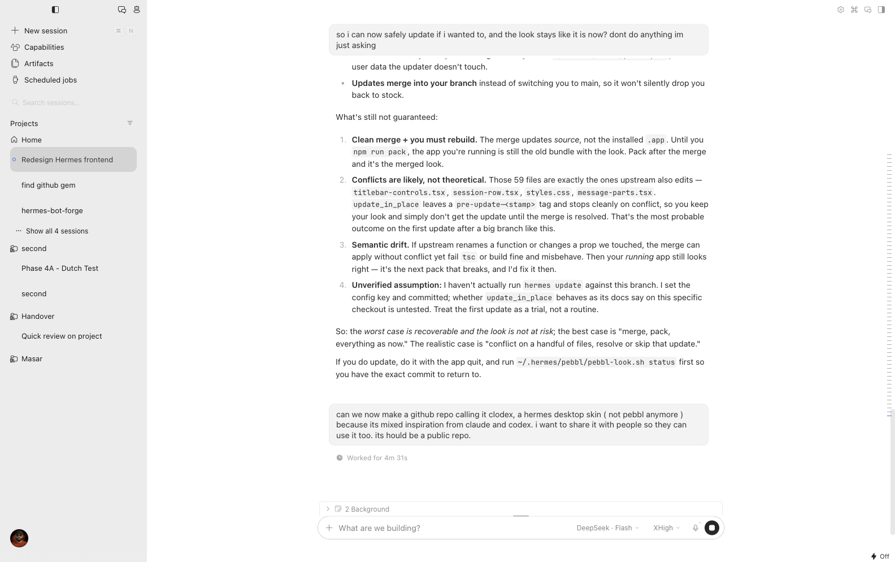

# Clodex — a Hermes desktop skin

A look for [Hermes Agent](https://github.com/NousResearch/hermes-agent)'s desktop app: Claude's warmth, Codex's neutrals, one blue accent. Not a reskin for its own sake — every surface was rebuilt around a single idea: **nothing decorative competes with the conversation.**



## What's in it

**Conversation.** A pill composer on a 760px measure. Your messages sit in soft bubbles at a 10px corner. Tool runs fold into one row that narrates the trailing command while it runs ("Running `npm run pack`") and settles into a count ("Ran 2 commands"); failures never fold, and the answer itself is never hidden.

**Sidebar.** Projects read as folders, sessions stack beneath them, name-only — no status dot clutter, no model line, no timestamps. Busy sessions beat once on a 6px dot. Hover highlights carry the same 10px corner as the bubbles.

**Chrome.** No tab strip above a single-pane chat. The chrome around the conversation is the conversation's surface; the sidebar keeps its own. Command Center lives in the titlebar where Settings is. The bottom bar keeps exactly one control that carries state you can't infer: the approval mode.

**Boot.** A boot splash in `index.html` shows the mark with a draw-on sweep, and the connecting screen keeps that same mark instead of spelling CONNECTING at you.

**Menus.** Every floating list — dropdowns, selects, popovers, right-click menus — at 10px, rows at 6px, so highlights nest.

## Two ways to use it

### 1. Colours only — no build (~2 minutes)

```sh
cp skin/clodex.yaml ~/.hermes/skins/
```

Restart Hermes and pick **Clodex** in Appearance (or `hermes skin use clodex` for the CLI). This is user data, so it survives `hermes update` — but it only supplies the palette: surfaces, strokes, hover states, the sidebar/chat split and the dark tooltips. The layout below stays stock.

### 2. Full look — patchset against the source (~5 minutes)

```sh
./scripts/apply.sh              # clones into ~/Projects/hermes-clodex and builds
```

Requires **Node ≥ 26** (the desktop app declares it) and pnpm. The script pins upstream `3b42157858`, applies six patches, installs, and packs the app.

| Patch | What it changes |
| --- | --- |
| `0001-theme` | the Clodex palette (light + dark) as a built-in theme |
| `0002-chat` | composer pill, turn fold, tool-run headers, bubble radius, copy |
| `0003-sidebar` | project tree, name-only rows, the Sessions/Bots switch, the busy dot |
| `0004-chrome` | tab strip, surface split, titlebar, minimal bottom bar, menus, 10px overlay cards |
| `0005-brand` | the draw-on sweep and the mark-only connecting screen |
| `0006-docs` | the design notes that go with all of the above |

## Honest caveats

- **Pinned, not tracked.** Patches apply cleanly to `3b42157858` and nothing else. When upstream moves they may conflict — that's expected. `git apply --3way` usually sorts it out.
- **macOS is what I built and tested on.** The patches are platform-neutral TypeScript/CSS, but the packaging step (`npm run pack`) I only ran on macOS arm64.
- **It's a fork-shaped patchset**, not a plugin: it edits the app's source. Hermes itself is MIT (© Nous Research); this repo's patches are MIT too, © the repo owner.
- **The account menu ships with a placeholder avatar.** Drop your own picture at `apps/desktop/src/assets/account/avatar.jpg` (square, ~256px) and it picks it up; the label follows your gateway profile name.

## Reverting

```sh
git checkout 3b42157858 && pnpm install && npm run pack
```

Nothing here touches your sessions, keys or config — only the app source and (option 1) one file in `~/.hermes/skins/`.

## Why "Clodex"

Claude's calm, Codex's discipline. The palette started as a screenshot-sampled mix of both: near-black neutrals (`#191919` transcript, `#252627` sidebar), one muted blue (`#407bd9`), grey hairlines instead of accent-tinted ones, and a light mode that's pure white on `#ececec` rather than warm cream.

MIT licensed. Built on [Hermes Agent](https://github.com/NousResearch/hermes-agent).
